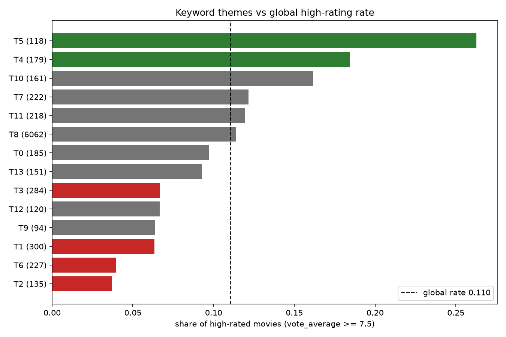
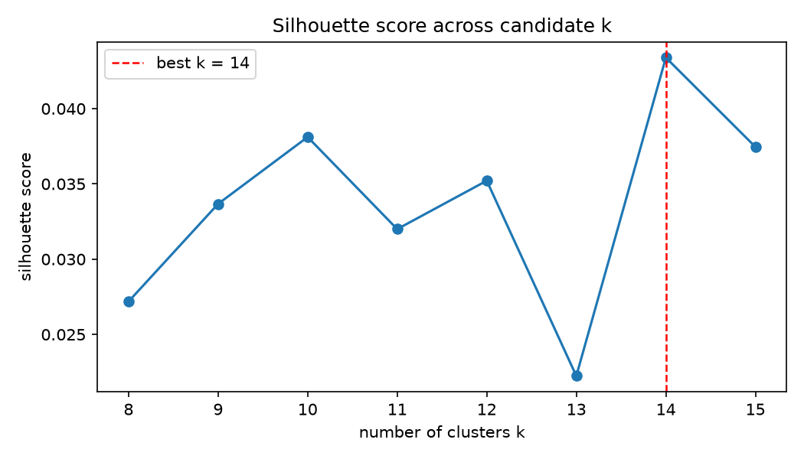

# Keyword-defined movie themes and their ratings

This report discovers themes purely from keyword data (not the official genre labels), then measures how each theme relates to ratings, and finds themes that rate surprisingly high, surprisingly low, or that defy what their own official genres would predict ('oddballs').

## Headline findings

- The global high-rating rate (TMDB `vote_average >= 7.5`) is **11.0%** across **8456** movies with 50+ TMDB votes.
- **HIGH**: theme T5 (world war ii | nazis | soldier | nazi germany | 1940s | pris...) is high-rated at 26.3%.
- **HIGH**: theme T4 (love | sex | based on novel | relationship | nudity | marria...) is high-rated at 18.4%.
- **LOW**: theme T2 (new york | independent film | sex | police | woman director ...) is high-rated at 3.7%.
- **LOW**: theme T6 (teenager | high school | based on young adult novel | teen m...) is high-rated at 4.0%.
- **LOW**: theme T1 (duringcreditsstinger | aftercreditsstinger | 3d | woman dire...) is high-rated at 6.3%.

## Data and working set

- Metadata rows read: **45466**; kept **45430** (dropped: 36 = 3 bad ids, 30 duplicates, 3 bad ratings, 0 bad vote counts).
- Keywords rows read: **46419**; kept **45432** (dropped: 0 bad ids, 987 duplicates, 14340 rows with no parseable keywords). 45429 metadata movies joined to keywords; 45429 keyword rows had metadata.
- Vote floor: `vote_count >= 50` removes **36287** of 45429 joined movies.
- Working set: **9142** movies unique by id, **973** high-rated.
- Vocabulary: **1000** keywords after deduping, dropping terms seen in < 3 or > 40% of movies, capped at 1000. 686 movies had no retained keywords.

## Method
- **Themes**: hard k-means on the cosine-normalized TF-IDF matrix of movie keywords. k was chosen by silhouette over 8-15 (`k = 14`, silhouette **0.0434**). Fixed seed 42 for full reproducibility.
- Clusters below **30** movies are excluded: **0** clusters ([]).
- **HIGH / LOW**: a theme is HIGH if its high-rate is above the global rate by more than the normal-approximation 95% CI (and LOW for the mirror case); otherwise it is 'baseline'.
- **Oddball**: each movie gets an *expected* high probability = mean high-rate of its own official genres; a theme's residual is observed minus expected. A theme is an oddball when the bootstrap 95% CI of its members' residuals excludes 0 (or, as a fallback, when |residual| >= 0.10 with >= 30 movies).
- **Validation**: per-theme mean of MovieLens (100K) user ratings, joined via `links_small.csv` to TMDB ids.

## Theme table

| T | size | mean | high% | lift | class | residual | keywords | genres |
|---|---|---|---|---|---|---|---|---|
| 0 | 185 | 6.41 | 9.7% | 0.88 | baseline | +0.016 | dystopia | post-apocalyptic | future | cyberpun… | Science Fiction(163), Action(108), Thriller(87)… |
| 1 | 300 | 6.18 | 6.3% | 0.57 | LOW | -0.031 | duringcreditsstinger | aftercreditsstinger | 3d… | Comedy(198), Action(72), Family(65), Adventure(… |
| 2 | 135 | 6.23 | 3.7% | 0.34 | LOW | -0.072 | new york | independent film | sex | police | wo… | Drama(84), Comedy(61), Romance(35), Thriller(31) |
| 3 | 284 | 6.27 | 6.7% | 0.61 | LOW | -0.064 | woman director | wedding | based on novel | chr… | Drama(161), Comedy(108), Romance(73), Thriller(… |
| 4 | 179 | 6.61 | 18.4% | 1.67 | HIGH | +0.071 | love | sex | based on novel | relationship | nu… | Drama(133), Romance(110), Comedy(78), Fantasy(2… |
| 5 | 118 | 7.09 | 26.3% | 2.38 | HIGH | +0.104 | world war ii | nazis | soldier | nazi germany |… | Drama(97), War(77), History(52), Action(36) |
| 6 | 227 | 6.17 | 4.0% | 0.36 | LOW | -0.054 | teenager | high school | based on young adult n… | Comedy(120), Drama(113), Romance(58), Horror(45) |
| 7 | 222 | 6.56 | 12.2% | 1.10 | baseline | -0.002 | independent film | woman director | duringcredi… | Drama(159), Comedy(99), Thriller(48), Romance(4… |
| 8 | 6062 | 6.38 | 11.4% | 1.03 | baseline | +0.011 | murder | based on novel | suspense | sport | vi… | Drama(2769), Comedy(2045), Thriller(1859), Acti… |
| 9 | 94 | 6.22 | 6.4% | 0.58 | baseline | -0.025 | martial arts | kung fu | based on video game | … | Action(87), Thriller(34), Drama(31), Adventure(… |
| 10 | 161 | 6.83 | 16.1% | 1.47 | baseline | +0.008 | biography | based on true story | sport | based… | Drama(142), History(36), Comedy(18), Crime(18) |
| 11 | 218 | 6.30 | 11.9% | 1.08 | baseline | +0.025 | revenge | murder | violence | rape | blood | pr… | Thriller(128), Action(95), Drama(93), Crime(65) |
| 12 | 120 | 6.17 | 6.7% | 0.60 | baseline | -0.011 | alien | alien invasion | spaceship | space mari… | Science Fiction(110), Adventure(43), Thriller(4… |
| 13 | 151 | 6.61 | 9.3% | 0.84 | baseline | -0.020 | musical | music | dance | animation | duringcre… | Drama(75), Comedy(73), Music(60), Family(59) |






## HIGH-rated themes

- **T4** — love | sex | based on novel | relationship | nu… [179 movies, high-rate 18.4%]
- **T5** — world war ii | nazis | soldier | nazi germany |… [118 movies, high-rate 26.3%]

## LOW-rated themes

- **T2** — new york | independent film | sex | police | wo… [135 movies, high-rate 3.7%]
- **T6** — teenager | high school | based on young adult n… [227 movies, high-rate 4.0%]
- **T1** — duringcreditsstinger | aftercreditsstinger | 3d… [300 movies, high-rate 6.3%]
- **T3** — woman director | wedding | based on novel | chr… [284 movies, high-rate 6.7%]

## Oddball themes

**Rating higher than genres predict (up):**

- **T8** — murder | based on novel | suspense | sport | vi… [6062 movies, high-rate 11.4%] (residual +0.011)
- **T4** — love | sex | based on novel | relationship | nu… [179 movies, high-rate 18.4%] (residual +0.071)
- **T5** — world war ii | nazis | soldier | nazi germany |… [118 movies, high-rate 26.3%] (residual +0.104)

**Rating lower than genres predict (down):**

- **T2** — new york | independent film | sex | police | wo… [135 movies, high-rate 3.7%] (residual -0.072)
- **T3** — woman director | wedding | based on novel | chr… [284 movies, high-rate 6.7%] (residual -0.064)
- **T6** — teenager | high school | based on young adult n… [227 movies, high-rate 4.0%] (residual -0.054)
- **T1** — duringcreditsstinger | aftercreditsstinger | 3d… [300 movies, high-rate 6.3%] (residual -0.031)

## MovieLens validation
MovieLens user ratings (100K set) confirm the headline ordering: theme T1 (low) — mean user rating **3.49** across 3760 ratings; theme T3 (low) — mean user rating **3.30** across 1002 ratings; theme T6 (low) — mean user rating **3.43** across 2187 ratings; theme T4 (high) — mean user rating **3.70** across 2211 ratings; theme T2 (low) — mean user rating **3.36** across 1320 ratings; theme T5 (high) — mean user rating **3.86** across 1725 ratings.

| T | mean ML rating | rated movies | ratings |
|---|---|---|---|
| 0 | 3.56 | 153 | 4413 |
| 1 | 3.49 | 247 | 3760 |
| 2 | 3.36 | 109 | 1320 |
| 3 | 3.30 | 119 | 1002 |
| 4 | 3.70 | 121 | 2211 |
| 5 | 3.86 | 80 | 1725 |
| 6 | 3.43 | 138 | 2187 |
| 7 | 3.68 | 167 | 1650 |
| 8 | 3.56 | 3995 | 64971 |
| 9 | 3.35 | 61 | 766 |
| 10 | 3.72 | 90 | 1073 |
| 11 | 3.59 | 149 | 1913 |
| 12 | 3.44 | 91 | 2034 |
| 13 | 3.61 | 98 | 2520 |

## Caveats

- **Working-set size**: the plan anticipated a ~30k-movie working set assuming a ~28k-row corrupted tail in `movies_metadata.csv`; this file is largely well-formed (only 36 of 45466 rows dropped), so the working set is driven by the `vote_count >= 50` floor and is **9,142** movies — a real property of the data, not a data-loss artifact.
- **Rating rounding**: TMDB stores `vote_average` rounded to 1 decimal, so scores like 7.49 vs 7.5 sit on the threshold; movies are labelled high only at `>= 7.5` exactly.
- **Vote-floor sensitivity**: the global high-rate at other floors is floor 25: 9.5% (13798 movies); floor 50: 10.6% (9142 movies); floor 100: 11.9% (6050 movies) — the baseline is stable around 11.0%.
- **Weak silhouette**: the silhouette score is low, and one catch-all theme absorbs 6062 movies; interpret individual labels as noisy clusters rather than crisp genres.
- **Genre-expected baseline** self-includes theme members (a mild circularity the project accepts); the MovieLens pass is an independent check.

## Reproducibility

```bash
python analysis/01-load.py
python analysis/02-vocab.py
python analysis/03-cluster.py
python analysis/04-ratings.py
python analysis/05-validate.py
python analysis/06-report.py
```

All random steps use seed 42. Tests: `pytest tests -q`.
